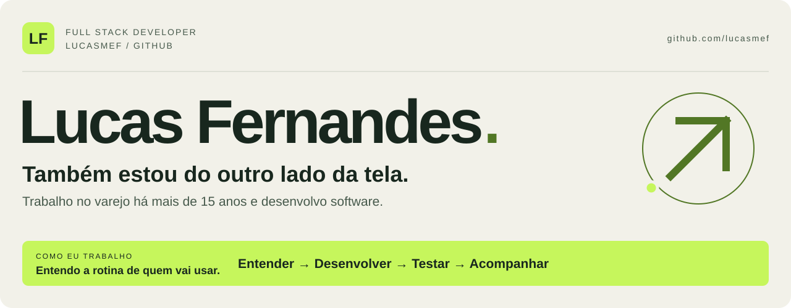
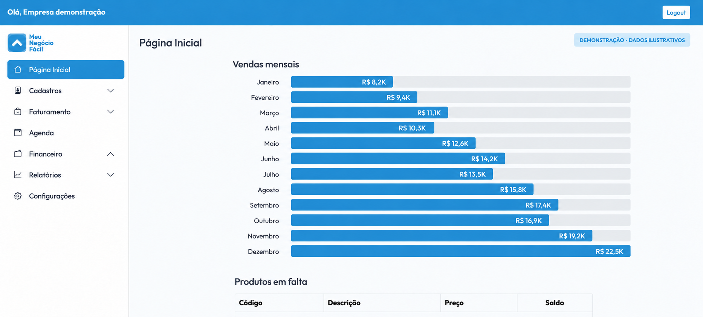
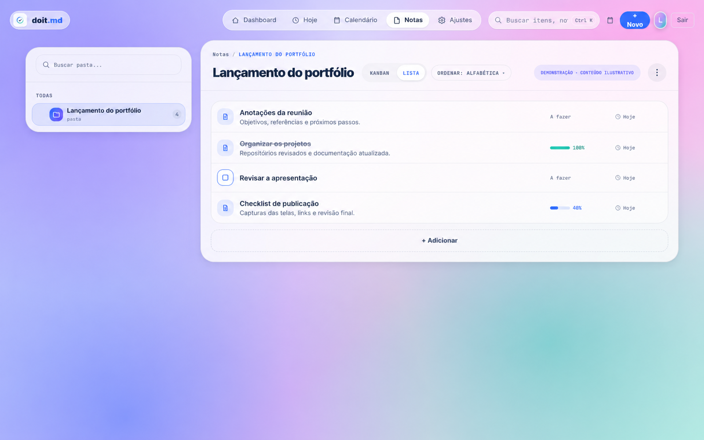

<picture>
  <source media="(prefers-color-scheme: dark) and (max-width: 600px)" srcset="./assets/header-dark-mobile.svg">
  <source media="(max-width: 600px)" srcset="./assets/header-light-mobile.svg">
  <source media="(prefers-color-scheme: dark)" srcset="./assets/header-dark.svg">
  
</picture>

  <a href="https://www.linkedin.com/in/lucasmef"><strong>LinkedIn</strong></a> ·
  <a href="mailto:lucasmef@gmail.com">E-mail</a> ·
  <a href="#user-content-projetos">Projetos</a> ·
  <a href="#user-content-codigo-publico">Código público</a>

## Desenvolvedor full stack

Sou desenvolvedor full stack e estudante de **Sistemas de Informação na PUC Minas**. Trabalho com **TypeScript, React, Next.js, Python e PostgreSQL** em aplicações web, APIs e automações.

Tenho mais de 15 anos de experiência no varejo, especialmente em vendas, estoque e gestão financeira. Essa experiência está presente em projetos como o ERP Meu Negócio Fácil e o sistema financeiro Salomão. **Busco uma oportunidade em desenvolvimento de software.**

## Projetos em destaque

### Meu Negócio Fácil · ERP acadêmico

ERP para pequenos negócios, entregue em equipe na PUC Minas com **JavaScript, HTML e CSS**, sem IA na implementação. Integra cadastros, vendas de produtos e serviços, estoque, financeiro, agenda e relatórios em uma SPA com persistência em localStorage.

**Minha contribuição:** arquitetura SPA, autenticação, PDV, gestão de insumos, dashboard e relatórios. Também atuei como Scrum Master, organizando o backlog e acompanhando as entregas da equipe.

Demonstração visual: captura da interface editada com dados ilustrativos.

`JavaScript` `HTML` `CSS` `localStorage` `SPA`

[Abrir o sistema](https://icei-puc-minas-pmv-si.github.io/pmv-si-2025-2-pe1-t1-pmv-si-2025-2-pe1-projmeunegociofacil/) · [Código](https://github.com/ICEI-PUC-Minas-PMV-SI/pmv-si-2025-2-pe1-t1-pmv-si-2025-2-pe1-projmeunegociofacil) · [Documentação e mais telas](./projetos/meu-negocio-facil.md)

### Salomão · Gestão financeira

Sistema financeiro em operação no varejo, com frontend em **React**, API em **FastAPI** e banco **PostgreSQL**. Reúne cobranças, conciliação bancária, contas a receber, planejamento de compras e projeções de caixa, com integrações com Banco Inter e Linx.

**Minha atuação:** frontend, API, modelagem de dados, integrações e manutenção na VPS. O projeto inclui MFA, auditoria, migrações de banco e ambientes separados de homologação e produção.

Demonstração visual: captura editada; nomes, valores e gráficos substituídos por dados ilustrativos.

`React` `TypeScript` `Python` `FastAPI` `PostgreSQL` `SQLAlchemy` `Redis` `Linux`

**Status:** em operação · Código privado

[Arquitetura e funcionalidades](./projetos/salomao.md)

### doit.md · PWA de produtividade

Aplicação de notas, tarefas e calendário com **editor Markdown**, checklists, histórico de versões e organização por pastas. Interface responsiva e instalação como PWA em desktop e mobile.

O monorepo reúne a aplicação **Next.js**, uma CLI em **Node.js** e pacotes compartilhados. As integrações com Google Calendar e Google Drive complementam a sincronização de notas com arquivos Markdown locais.

Demonstração visual: captura da interface editada com dados ilustrativos.

`Next.js` `React` `TypeScript` `Node.js` `PWA` `SQLite` `PostgreSQL`

**Status:** projeto em pausa, versão online desativada · Código público

[Código](https://github.com/lucasmef/doit.md) · [Telas e arquitetura](./projetos/doit.md)

### Smart Shop · E-commerce de moda

E-commerce para a loja Raquel Talita, com seleção de peças e tamanhos a partir de looks completos. O projeto reúne catálogo, sacola, checkout, reserva de estoque e painel administrativo.

A aplicação usa **Next.js e TypeScript**, PostgreSQL e Supabase, com integrações de pagamento e cotação de frete. As reservas de estoque consideram o saldo comprometido por outros pedidos.

`Next.js` `React` `TypeScript` `PostgreSQL` `Supabase` `Vercel`

**Status:** em desenvolvimento, vendas ainda não abertas · Código privado

[Funcionalidades e estágio do projeto](./projetos/smart-shop.md)

## Ferramentas e automação

### Send Mail · Fila de e-mails via CLI

CLI em **Python** para preparar, revisar e enviar e-mails. A fila em **SQLite** mantém o histórico e permite retomar a execução. O controle de concorrência e o tratamento de falhas de confirmação reduzem o risco de envios duplicados. Credenciais no Keychain e conexão SMTP com TLS.

`Python` `SQLite` `SMTP` `IMAP` `macOS Keychain`

[Código](https://github.com/lucasmef/send-mail) · [Persistência e recuperação de falhas](./projetos/send-mail.md)

### Reel Transcribe · Transcrição de vídeos

Ferramenta para download de Reels públicos autorizados e transcrição ou tradução da fala com Gemini.

[Código e instruções](https://github.com/lucasmef/reel-transcribe)

### BuilderFlow · Templates para desenvolvimento com agentes

Conjunto de templates para documentar contexto, especificações e decisões de arquitetura no desenvolvimento com agentes de IA. Uma CLI em **Node.js** instala a estrutura no repositório e preserva os documentos existentes por padrão.

`Node.js` `JavaScript` `Markdown` `CLI`

[Código](https://github.com/lucasmef/builder-flow) · [Estrutura dos templates](./projetos/builderflow.md)

## Áudio, vídeo e aplicações macOS

### LookPrint · Extração de quadros de vídeos de moda

Aplicativo macOS em **SwiftUI** que seleciona quadros em que um look está completo e estável no vídeo. Usa **AVFoundation e Vision** para análise e exportação local das imagens, com integração ao Finder.

`Swift` `SwiftUI` `AVFoundation` `Vision`

[Código](https://github.com/lucasmef/print-videos) · [Seleção e exportação de quadros](./projetos/lookprint.md)

### Proxies Maker · Conversão de vídeo em lote

Conversor de vídeo em lote para macOS, com interface em **Swift** e processamento em **Python com FFmpeg**. Gera versões leves para consulta, com fila, acompanhamento de progresso e verificação da saída. Inclui uma variante experimental com VideoToolbox.

`Swift` `Python` `FFmpeg` `VideoToolbox`

[Código](https://github.com/lucasmef/proxies-maker) · [Conversão e validação](./projetos/proxies-maker.md)

### Sinal IA · Inspeção de metadados

Scanner local de **XMP, IPTC e estruturas C2PA** em imagens e vídeos. Exibe declarações de uso de IA presentes no arquivo, com limites de leitura e profundidade no parser. A análise se restringe aos metadados; não classifica a imagem nem valida assinaturas criptográficas.

`Swift` `Parsing binário` `XMP` `IPTC` `C2PA`

[Código](https://github.com/lucasmef/anti-ia) · [Formatos e limites da análise](./projetos/sinal-ia.md)

### Rosto Natural · Processamento facial em vídeo

Núcleo em **C++** para suavização de pele e correções localizadas, com máscaras faciais, rastreamento por **MediaPipe** e estabilização temporal. A implementação em CPU serve de referência para a integração com Metal e Adobe UXP.

`C++` `MediaPipe` `Metal` `Python` `Adobe UXP`

**Status:** núcleo avaliado fora do Premiere; integração completa com o editor pendente.

[Código](https://github.com/lucasmef/rosto-natural) · [Processamento e testes de imagem](./projetos/rosto-natural.md)

### Voz Neural · Processamento local de voz

Redução de ruído com **DeepFilterNet**, detecção de atividade vocal com **RNNoise** e ajustes de timbre e nível com processamento de sinal. O processamento em Python e NumPy gera um novo arquivo WAV em dual mono, preservando o áudio original.

`Python` `NumPy` `DeepFilterNet` `RNNoise` `C++` `Adobe UXP`

**Status:** núcleo local funcional; painel UXP e ponte C++ para o Premiere em desenvolvimento. Calibração para voz feminina falada.

[Código](https://github.com/lucasmef/voz-neural) · [Processamento e integração](./projetos/voz-neural.md)

### Editor Viral · Edição programática com Remotion

Ferramentas de edição programática com **Remotion** para montar trechos, legendas, cartões e zooms. Os scripts mantêm a referência de cada corte ao material original e organizam a revisão antes da transferência para o Adobe Premiere Pro.

`TypeScript` `React` `Remotion` `Python` `FFmpeg`

**Status:** piloto em validação; fluxo completo e transferência de efeitos pendentes de teste no editor.

[Código](https://github.com/lucasmef/editor-viral) · [Estrutura e estágio do projeto](./projetos/editor-viral.md)

## Projetos em equipe

### Loja de Jogos Usados · Projeto acadêmico

Aplicação modular em **JavaScript com ES Modules**. Minha participação abrange cadastro de clientes, vendas, registro de pagamentos e baixa de estoque, além das especificações e dos contratos de integração entre módulos.

`JavaScript` `HTML` `CSS` `ES Modules` `localStorage` `Node.js Test Runner`

**Acesso ao código:** restrito à equipe da faculdade.

## Práticas de desenvolvimento

- Registro regras de negócio, contratos entre módulos e decisões de arquitetura no repositório.
- Valido mudanças com testes de regras de negócio, integrações e fluxos da aplicação.
- No Salomão, também cuido das migrações de banco, dos serviços na VPS e da verificação após o deploy.

Uso agentes de IA como apoio à implementação e à revisão nos projetos atuais. A definição das regras de negócio, a revisão das alterações e a validação das entregas ficam sob minha responsabilidade.

## Tecnologias

- **Web e backend:** TypeScript, JavaScript, React, Next.js, Python, FastAPI, HTML e CSS.
- **Dados e infraestrutura:** PostgreSQL, SQLAlchemy, Prisma, Supabase, Redis, GitHub Actions, Linux, Docker e Nginx.
- **Áudio e vídeo:** Swift, C++, NumPy, MediaPipe, Metal, FFmpeg e Adobe UXP, conforme o projeto.

## Formação e cursos

Sistemas de Informação · PUC Minas · em andamento. 
Tecnólogo em Marketing · Unisul · 2022.

AWS Academy: Cloud Foundations, Cloud Developing e Generative AI Foundations. 
Vercel: Next.js App Router Fundamentals e React Foundations for Next.js.

## Contato

[LinkedIn](https://www.linkedin.com/in/lucasmef) · [lucasmef@gmail.com](mailto:lucasmef@gmail.com)
