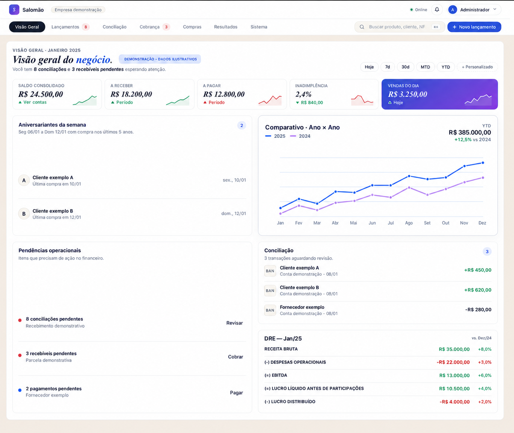

[← Voltar ao perfil](../README.md#user-content-projetos)

# Salomão

## Gestão financeira para a rotina do varejo

Sistema de gestão financeira em operação no varejo, com módulos de cobranças, conciliação bancária, compras, contas a receber e projeções de caixa. A arquitetura combina frontend React, API FastAPI e PostgreSQL.

As regras de negócio relacionam vendas a recebimentos e compras parceladas às projeções mensais de caixa.

Demonstração visual: captura editada; nomes, valores e gráficos substituídos por dados ilustrativos.

### Responsabilidades técnicas

Sou responsável pelo frontend, pelos endpoints da API e pela modelagem de dados, incluindo integrações com Banco Inter e Linx, importações e relatórios.

Também cuido dos serviços na VPS, das migrações do banco e da verificação após os deploys. Homologação e produção usam ambientes separados; o deploy em produção exige acionamento manual.

### Autenticação, integrações e validação

- Integração bancária para consultar movimentações e acompanhar cobranças.
- Autenticação com MFA e registros de auditoria para controlar o acesso e consultar alterações.
- Compras e parcelas ligadas ao planejamento de caixa.
- Testes das regras e dos fluxos antes de atualizar a aplicação em uso.

Uso agentes de IA no apoio à implementação e à revisão. Sou responsável por definir o escopo, validar as alterações e liberar as atualizações.

O código é privado. Esta página apresenta o trabalho sem expor dados financeiros da operação.

`React` `TypeScript` `FastAPI` `Python` `PostgreSQL` `SQLAlchemy` `Redis` `GitHub Actions` `Linux`

[Conversar sobre o Salomão](mailto:lucasmef@gmail.com?subject=Projeto%20Salom%C3%A3o)

[LinkedIn](https://www.linkedin.com/in/lucasmef) · [E-mail](mailto:lucasmef@gmail.com) · [Voltar ao perfil](../README.md)
